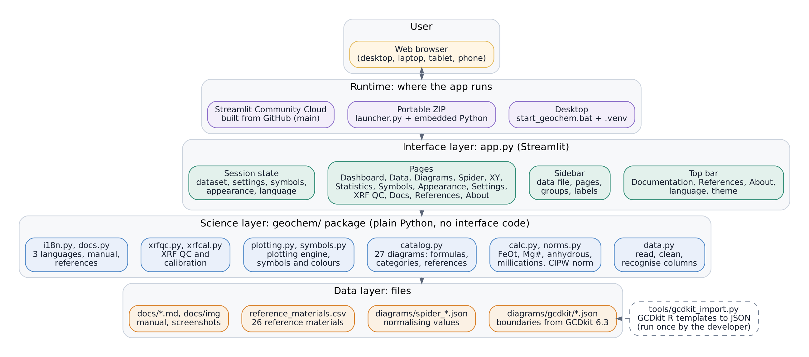
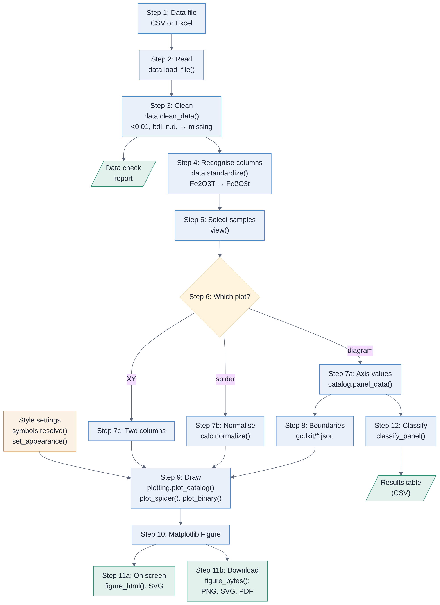
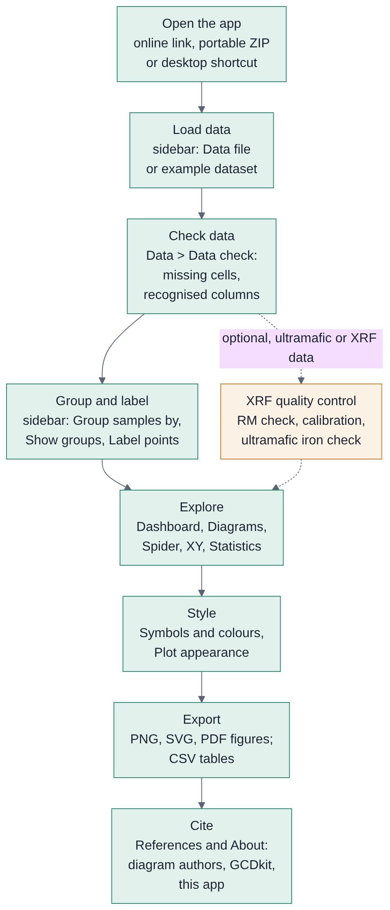
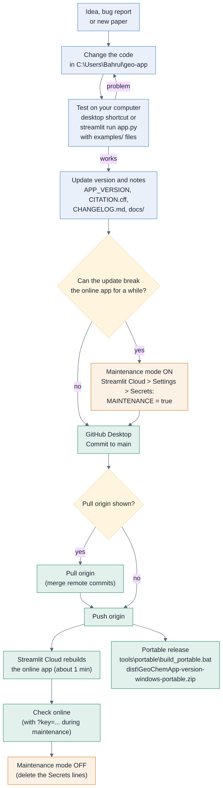
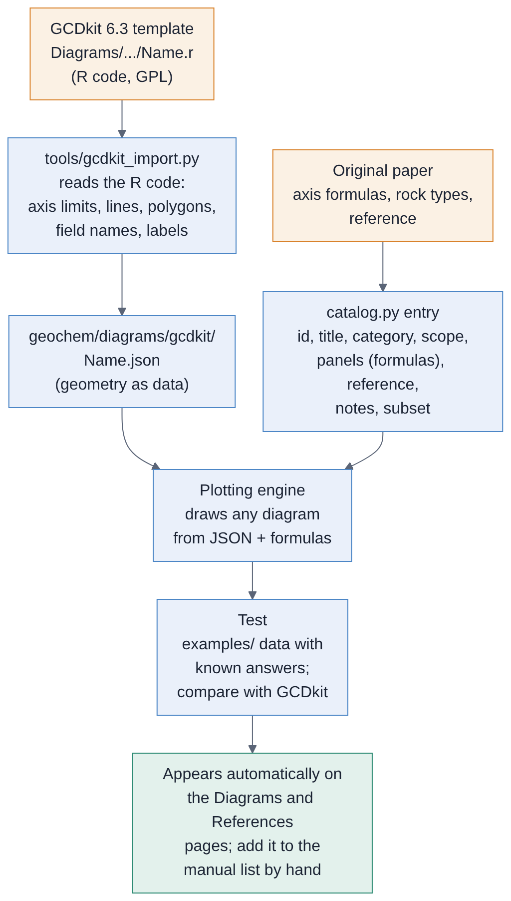

# GeoChem App architecture and workflows

This document explains how GeoChem App is built, how data travel from a file
to a figure, and the workflows for users and developers. It is written for
people who want to understand, check or extend the app. No deep programming
knowledge is needed to follow the diagrams.

## 1. Design principles

| Principle | What it means in the app |
|---|---|
| **Science separate from the interface** | All geochemistry (cleaning, formulas, norms, diagrams, plotting) lives in the `geochem/` package as plain Python. `app.py` only arranges pages and buttons. The science code can be tested, reused in scripts, or given a new interface without change. |
| **Diagrams are data** | Boundary lines, polygons and field names are stored as JSON files converted from the R templates of Janoušek et al. (2006). Axis formulas and references are short entries in `catalog.py`. One plotting engine draws every diagram, so a new diagram needs no new drawing code. |
| **Faithful to the sources** | Boundaries are copied unchanged from Janoušek et al. (2006), so a sample falls in the same field as in their implementation. Every diagram carries its original reference, and calculations are checked against published values (for example the XRF module against Mikuni et al. 2025). |
| **Friendly to beginners** | Lab files are read as they are (`<0.01`, `bdl`, decimal commas, units rows), every change is reported, and messages tell the user what is missing. |
| **Nothing happens behind the user's back** | Figures are shown as inline SVG and download files are made only when a button is clicked, so download managers are not triggered and no file is written unasked. |
| **One code base, three ways to run** | The same code runs on the desktop, in the portable Windows ZIP and online on Streamlit Community Cloud. Library versions are pinned in `requirements.txt` for reproducible results. |
| **Open and citable** | GPL-3.0, as required for work derived from Janoušek et al. (2006). References, `CITATION.cff` and the About page make correct citation easy. |

## 2. Architecture



The app has four layers. Each layer only uses the layer below it.

### 2.1 Runtime: where the app runs

| Runtime | How it starts | Notes |
|---|---|---|
| Desktop | `start_geochem.bat` runs Streamlit with the project's `.venv` | Developer's own computer |
| Portable ZIP | `Start GeoChem App.bat` runs `launcher.py` with the embedded Python 3.12 | Finds a free port and opens the browser; no installation, no internet |
| Online | Streamlit Community Cloud builds the app from the GitHub `main` branch | Detected by its `/mount/src` path (or `GEOCHEM_HOSTED=1`): shows a privacy note, moves the top bar below the Cloud toolbar, and allows maintenance mode through Secrets |

### 2.2 Interface layer: `app.py`

`app.py` is a Streamlit script. Streamlit runs the whole script again after
every click and rebuilds the page; values that must survive are kept in
**session state**.

| Part | Role |
|---|---|
| Session memory | `dataset`, `settings`, `symbols`, `appearance`, `lang`, display choices. Also copied to a small server-side store under the `?s=` token in the address, so a page reload (for example a theme change) restores the session. At most 50 sessions are kept. |
| Theme | Light, dark or system. The choice is stored in the browser for every page address, then the page reloads. |
| Maintenance mode | Read from Streamlit Secrets (`MAINTENANCE`, `MAINTENANCE_MESSAGE`, `MAINTENANCE_KEY`). Stops the script with a notice page unless the developer key is given. |
| Data loading | `process()` reads, cleans and standardises the uploaded file once; the result is cached by file content. |
| Project page | Save and open project files; choose the work folder (not online); open data files and projects from it. A project is applied at the start of the next run, before any widget is drawn. |
| Top bar | Brand, Documentation, References, About, language and theme menus. |
| Sidebar | Data file, page links, *Group samples by*, *Show groups*, *Label points with*. |
| Pages | One function per page (`page_dashboard()`, `page_diagrams()` ...). Pages call the science layer and show results. |
| Helpers | `view()` (selected samples), `opts()` (symbols, labels, legend), `show()` (inline SVG), `downloads()` (files made on click). |

### 2.3 Science layer: the `geochem/` package

| Module | Responsibility |
|---|---|
| `data.py` | Read CSV/Excel (with a chosen header row); clean text values; recognise column names (`SiO2 (wt%)` to `SiO2`); detect and convert units (wt%, ppm, ppb); apply the user's column setup; report changes |
| `calc.py` | FeOt, Mg#, anhydrous recalculation, molar values, millications, element from oxide, normalisation |
| `norms.py` | CIPW norm (Hutchison 1974, 1975; ported from Janoušek et al. 2006), iron split by Fe³⁺/Fe(total) |
| `masschange.py` | Mass change: isocon slope, gains and losses (Grant 1986, 2005), enrichment factors and immobility test (MacLean and Barrett 1993); used by Tools → Mass change |
| `variation.py` | Variation diagrams: Harker (SiO2) and MgO plates, anhydrous or as measured; iso-Mg# and olivine lines |
| `examples.py` | Example datasets: list, descriptions and loading; real reference rocks from `examples/reference_rocks.csv` (USGS certificates; Mikuni et al. 2025) and two synthetic sets |
| `screening.py` | Checks before naming: IUGS high-Mg rules and nephelinites before TAS, freshness for TAS, ultramafic samples, MgO deficit against the terrestrial array |
| `catalog.py` | The 34 diagrams: title, category, rock scope, year, axis formulas per panel, sample subset, notes, reference |
| `plotting.py` | Plotting engine: binary, ternary and logarithmic panels, multi-panel plates, spider and XY plots, sample classification (point in polygon), styles (dark, light, publication) and appearance options |
| `symbols.py` | Colour, symbol and size per group; palettes; per-sample style columns (Janoušek et al. 2006) |
| `xrfqc.py`, `xrfcal.py` | Optional XRF module: reference-material QC, calibration from intensities with matrix correction, ultramafic iron check (Mikuni et al. 2025) |
| `i18n.py` | Interface text in Indonesian, English and Japanese (English text is the key) |
| `docs.py` | Splits the documents into chapters, embeds images, builds the reference list |
| `project.py` | Project files (`.geochem` ZIP: data + session as JSON) and the work folder (data, exports, projects; remembered in `~/.geochem_app/config.json`) |

### 2.4 Data layer: files

| File(s) | Content |
|---|---|
| `geochem/diagrams/gcdkit/*.json` | Boundary geometry of each diagram (lines, polygons, field names, label positions, axis limits) |
| `geochem/diagrams/gcdkit/discriminants.json` | Discriminant-function formulas (Agrawal et al. 2008, Verma et al. 2006) |
| `geochem/diagrams/spider_norms_gcdkit.json` | 35 sets of normalising values for spider diagrams (chondrite, primitive mantle, MORB, OIB, crust, sediments) as compiled by Janoušek et al. (2006) |
| `geochem/reference_materials.csv` | Reference values of 26 rock reference materials (Mikuni et al. 2025, Table 1) |
| `docs/` | User manual, this document, deployment guide, screenshots and diagrams |
| `examples/` | Example data with known answers |

`tools/gcdkit_import.py` converts the R templates of Janoušek et al. (2006) into the JSON files.
`tools/lee2003_vmgo.py` calculates the V–MgO melting curves of Lee et al. (2003) and writes
their geometry file.
The developer runs it once per diagram; users never need it.

## 3. From data to visualisation



1. **Data file.** One sample per row, column names in the first row.
2. **Read** (`data.load_file`). CSV or Excel into a table.
3. **Clean** (`data.clean_data`). Text such as `<0.01`, `bdl`, `n.d.` becomes
   a missing value (never zero); decimal commas are read; rows without
   numbers (units rows) are removed. Every change goes into the **data
   check report**.
4. **Recognise columns and units** (`data.detect_units`,
   `data.standardize`). Lab spellings become standard names, so `Fe2O3T`,
   `Fe2O3*` and `T-Fe2O3` all become `Fe2O3t`. Units found in the column
   names or in a units row are converted (oxides to wt%, elements to ppm,
   for example ppb / 1000). The user's **column setup** (header row, sample
   name, rock type, locality, group, meaning and unit of each column) is
   applied here; the sample column is moved to the front.
5. **Select samples** (`view`). Groups hidden in the sidebar are left out.
6. **Choose a plot.**
7. **Calculate the axis values.**
   - Classification and discrimination diagrams: `catalog.panel_data`
     applies the formulas of the chosen diagram (for example anhydrous
     SiO2 and Na2O + K2O for TAS, millications for R1-R2, CIPW norm for
     FSSI, discriminant functions for Verma et al. 2006). A missing column
     raises a clear message instead of a wrong plot.
   - Spider diagrams: `calc.normalize` divides each element by the
     normalising value.
   - XY plots: the two chosen columns.
   - Ternary plots: `calc.ternary_closure` sums the chosen columns of each
     apex, applies the factor and closes A, B and C to 100 %.
8. **Load the boundaries** of the diagram from its JSON file.
9. **Draw** with the plotting engine. Symbols and colours come from
   `symbols.resolve` (group styles or the file's own style columns); fonts,
   label orientation, line widths and size come from the appearance
   settings. Ternary coordinates use x = c + b/2, y = b·√3/2 as in Janoušek et al. (2006),
   apex order (a left, b top, c right).
10. **Figure.** A Matplotlib `Figure` object (safe for several users at the
    same time).
11. **Output.** On screen as inline SVG (`figure_html`); as PNG, SVG or PDF
    only when a download button is clicked (`figure_bytes`), in the
    publication style and the chosen resolution.
12. **Classify.** `plotting.classify_panel` finds the field polygon that
    contains each sample; the **Results** tab lists the field of every
    sample and the counts.

## 4. How a diagram is defined

A diagram has two parts.

**The catalogue entry** (`geochem/catalog.py`), for example TAS:

```python
dict(id="TAS", title="TAS (Le Bas et al. 1986)", category="Classification",
     scope="Volcanic rocks", year=1986, iugs=True,
     panels=[B(lambda d, s: anh(d, s)["SiO2"],                     # x axis
               lambda d, s: anh(d, s)["Na2O"] + anh(d, s)["K2O"],  # y axis
               "SiO2 (wt%)", "Na2O + K2O (wt%)", "anhydrous")],
     reference="Le Bas M.J. et al. (1986) ... Journal of Petrology 27, 745-750.",
     notes="IUGS-recommended classification of fresh volcanic rocks ...")
```

`B(...)` defines a binary panel (x and y formulas); `T(...)` a ternary panel
(a, b and c formulas and the apex labels). A diagram can have several panels
and an optional `subset` (for example SiO2 < 52 wt% for Verma et al. 2006).

**The geometry file** (`geochem/diagrams/gcdkit/TAS.json`): axis limits and
log scales, boundary lines (with width and dash), field polygons with their
names, text labels with position and rotation, all converted from
`GCDkit 6.3/Diagrams/Classification/English/TAS.r`.

## 5. Workflows

### 5.1 User workflow



### 5.2 Developer workflow: change, test, publish



- Use **maintenance mode** when an update may break the online app for a
  while; switch it off after checking the online app.
- If GitHub Desktop shows **Pull origin**, pull first (GitHub has a commit
  that your computer does not have), then push.
- Build a new portable ZIP for each release.

### 5.3 Adding a new diagram



1. Find the R template of Janoušek et al. (2006) (`GCDkit 6.3/Diagrams/...`) and the original
   paper.
2. Convert the template with `tools/gcdkit_import.py`; check the JSON.
3. Add a `catalog.py` entry: axis formulas from the paper, category, rock
   scope, year, reference and notes on correct use.
4. Test with data whose answers are known; compare with the published implementation (Janoušek et al. 2006).
5. Add the diagram to the list in the user manual (chapter 7).

### 5.4 Adding or changing interface text

Write the English text in `app.py` inside `t("...")` and add the Indonesian
and Japanese translations to `geochem/i18n.py`. Missing translations fall
back to English.

## 6. Key technical decisions

| Decision | Reason |
|---|---|
| Python + Streamlit | One language for science and interface; runs in any browser; free hosting |
| Template geometry (Janoušek et al. 2006) converted to JSON, not re-drawn by hand | Exact boundaries, easy checking, new diagrams without new code |
| Matplotlib `Figure` objects (not `pyplot`) | Safe when several users or downloads run at the same time |
| Inline SVG on screen, downloads made on click | No automatic downloads (download managers), crisp figures |
| Session copy under the `?s=` token | The page can reload (theme change) without losing data |
| English text as translation key | Code stays readable; any missing translation shows English |
| Pinned library versions | Same results on every computer and online |
| GPL-3.0 | Required for work derived from Janoušek et al. (2006) |

## 7. Editing these diagrams

The diagram sources are in `docs/diagrams/`:

- `architecture.dot` (Graphviz): `dot -Tpng -Gdpi=170 architecture.dot -o ../img/diagrams/architecture.png`
- `dataflow.mmd`, `user-workflow.mmd`, `dev-workflow.mmd`, `new-diagram.mmd`
  (Mermaid). GitHub shows `.mmd` files as text; paste them into
  mermaid.live to edit and export PNG or SVG.
