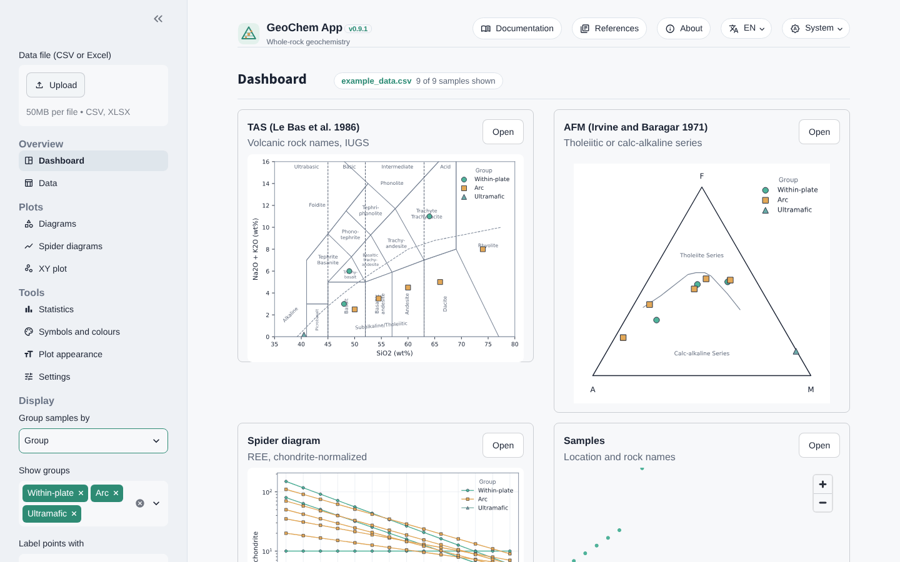
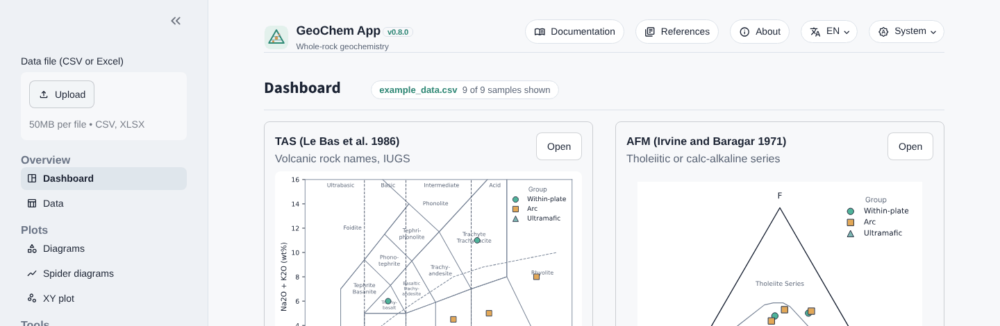
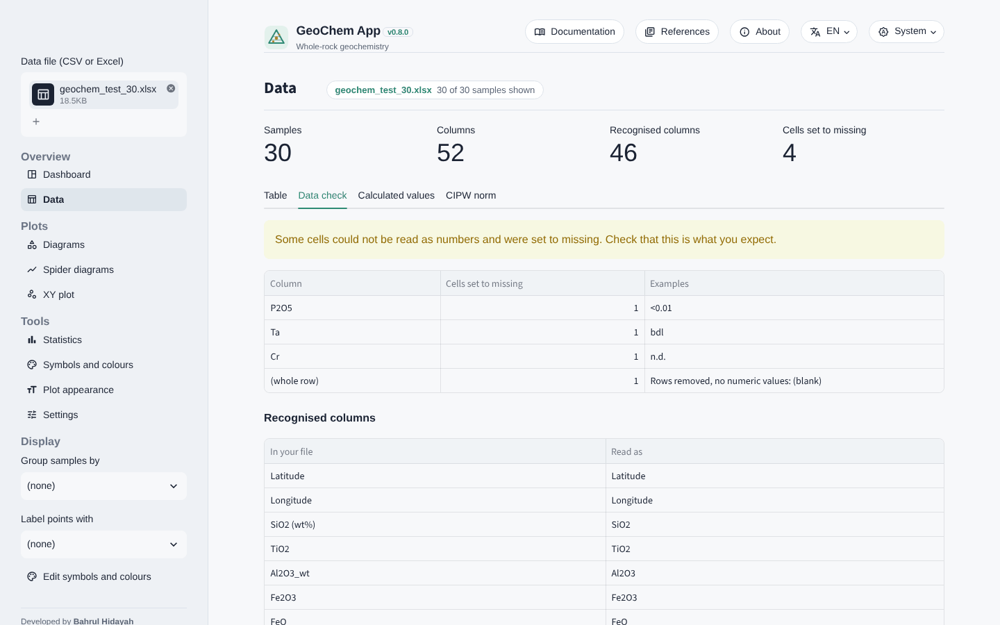
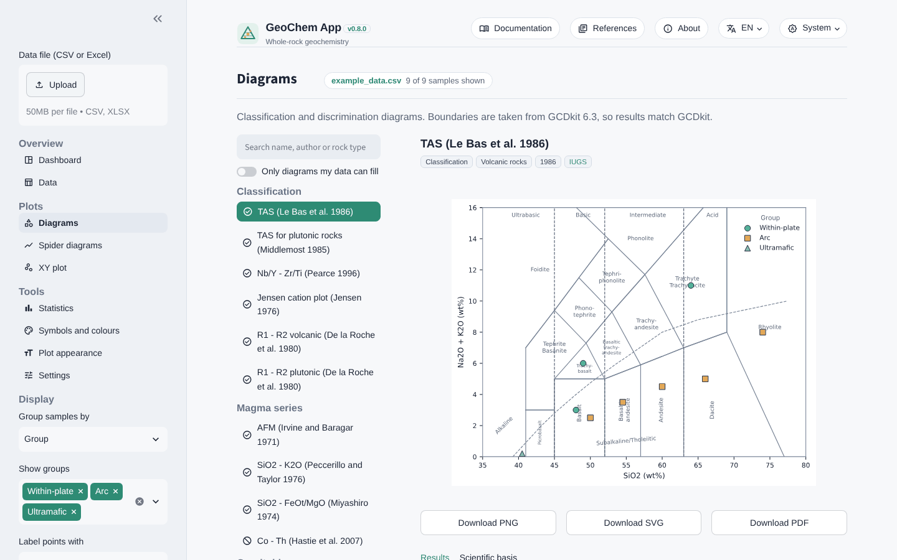
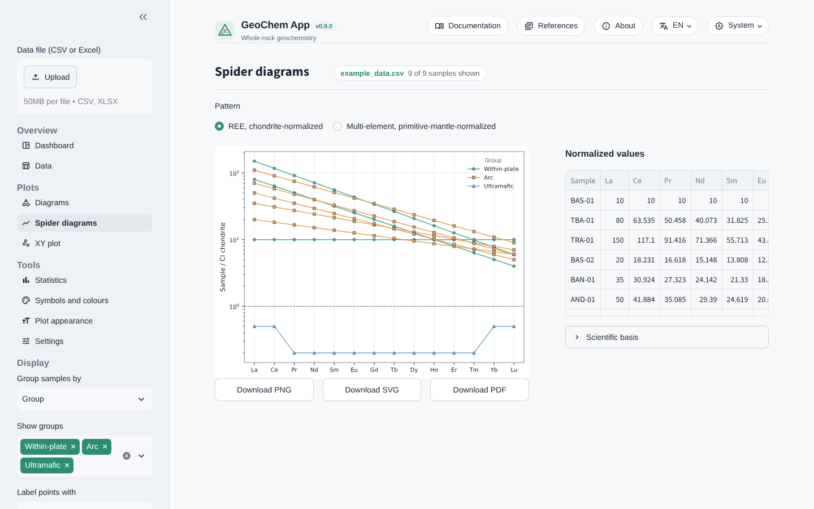
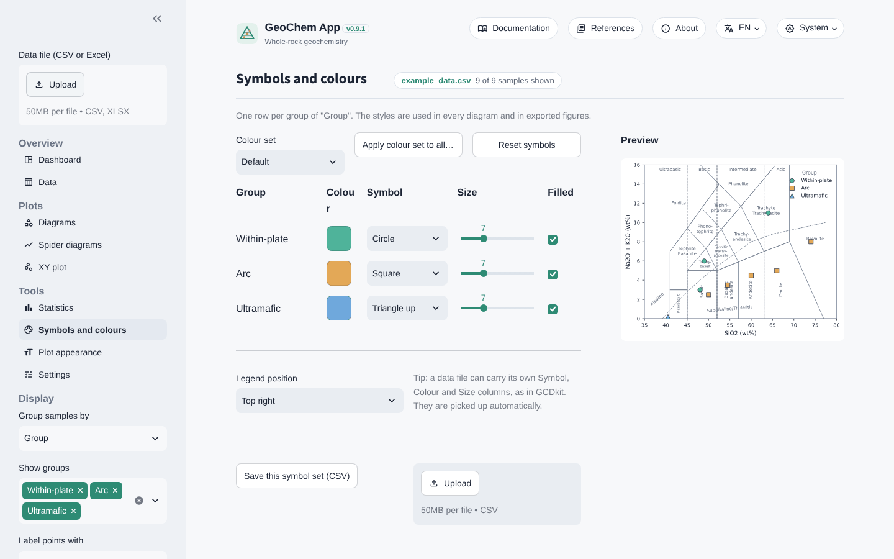
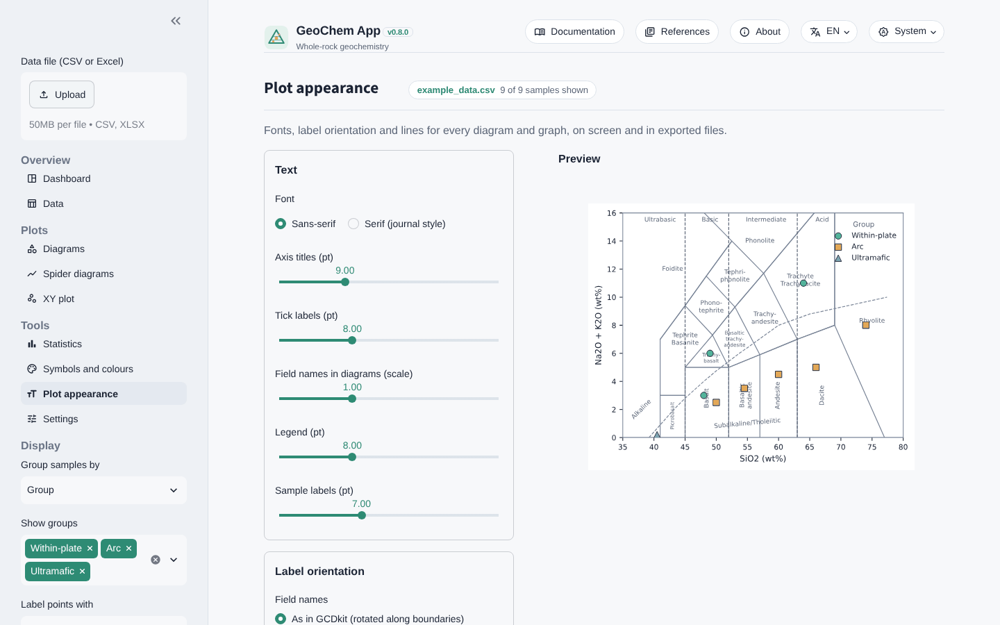
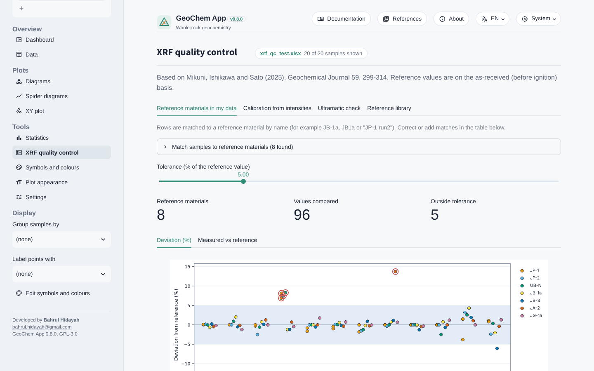
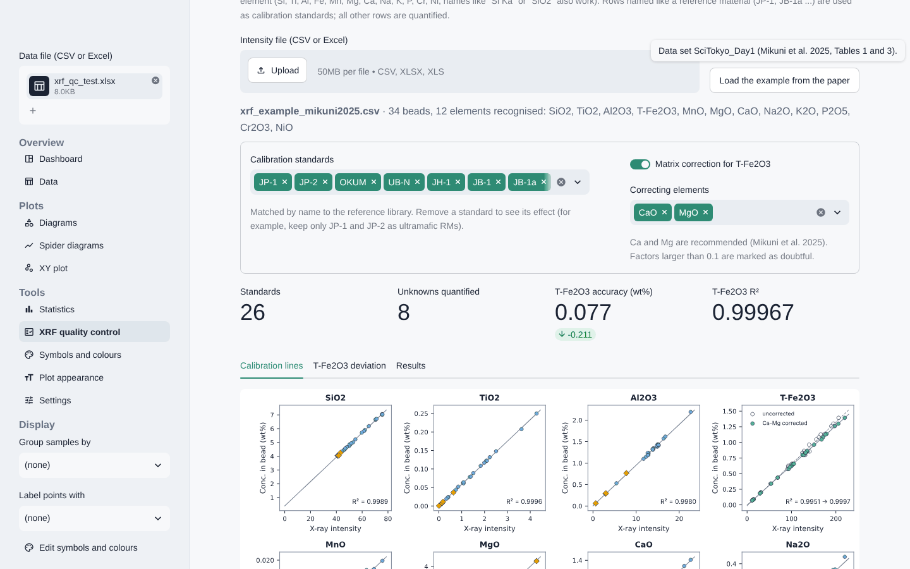

# GeoChem App user manual

GeoChem App is a free, open-source web application for whole-rock
geochemistry. It runs in your web browser and does not need an internet
connection or a programming background. Classification and discrimination
diagrams follow GCDkit (Janoušek et al. 2006), so your results match the
published boundaries.

This manual explains every page of the app, the data format and the
calculations, so that you can use the results in theses and papers with
confidence. It is written for beginners: no previous experience with
programming or with GCDkit is needed.

## 1. Introduction

### What the app does

- Reads your data from a CSV or Excel file and cleans it for you
  (values below detection limit, decimal commas, units rows).
- Plots **27 classification and discrimination diagrams** from GCDkit,
  grouped into six categories, and names the field of every sample.
- Draws REE and multi-element **spider diagrams**, free **XY plots** and
  **group statistics**.
- Calculates FeOt, Mg#, anhydrous values and the **CIPW norm**.
- Lets you choose the **symbol, colour and size** of each group and the
  **appearance** of every plot (fonts, label orientation, line widths).
- Exports figures as **PNG, SVG and PDF** in a clean publication style,
  and tables as CSV.
- Offers an optional **XRF quality-control module** (Mikuni et al. 2025):
  reference-material checks, calibration from raw X-ray intensities with
  matrix correction, and an iron check for ultramafic rocks.
- Works in **English, Indonesian and Japanese**, with a light, dark or
  system theme.

### What the app does not do (yet)

- It does not interpret your data for you. A diagram shows where samples
  plot; the geological meaning is your decision.
- Mineral chemistry (EPMA), XRD, SEM-EDX and Raman tools are planned for
  later versions.

### Where your data go

- **Desktop and portable versions:** the app runs on your own computer. Your
  files are read in memory and are not uploaded anywhere. Closing the app
  forgets the data.
- **Online version:** your file is sent to the server that runs the app,
  processed in memory and not saved. For confidential data, use the desktop
  or portable version (chapter 19).

## 2. Quick start

### Start the app

- **Online (no installation):** open https://geo-app-hidayah.streamlit.app
  in any browser.
- **Portable Windows version:** extract the ZIP file and double-click
  *Start GeoChem App.bat* (chapter 19).
- **Windows (with the shortcut):** double-click **GeoChem App** on the
  Desktop. A black window opens (this is the app engine; keep it open) and
  your browser opens the app at `http://localhost:8501` after a few seconds.
- **Any system (from a terminal):**

```
cd path/to/geo-app
.venv\Scripts\Activate.ps1        (Windows PowerShell)
source .venv/bin/activate         (macOS or Linux)
streamlit run app.py
```

To stop the app, close the black window (or press `Ctrl+C` in the terminal).

### Install (first time only)

1. Install Python 3.11 or newer from python.org.
2. Open a terminal in the app folder and create a virtual environment
   (a private Python for this app): `python -m venv .venv`
3. Activate it (see above) and install the libraries:
   `pip install -r requirements.txt`
4. On Windows, if PowerShell refuses to activate the environment, run once:
   `Set-ExecutionPolicy -Scope CurrentUser RemoteSigned`

### Your first diagram in three steps

1. Click **Data file (CSV or Excel)** in the left panel and choose your file,
   or click **Try the example dataset** on the start page.
2. The **Dashboard** shows TAS, AFM, a spider diagram and a sample table.
3. Open **Diagrams** in the left panel and click any diagram in the list.



## 3. Preparing your data

### Table layout

- One sample per **row**, one variable per **column**.
- Column names in the **first row**.
- The **first column** should hold the sample names (or choose the sample
  column in **Data → Column setup**). The order of the other columns does not
  matter.
- Text columns (for example *Group*, *Locality*, *Rock type*) can be used to
  group and label samples.
- CSV (comma separated) and Excel (`.xlsx`) files are accepted.

| Sample | Group | SiO2 | TiO2 | Al2O3 | Fe2O3t | MgO | CaO | Na2O | K2O | La | Ce | Nb | Zr |
|---|---|---|---|---|---|---|---|---|---|---|---|---|---|
| BAS-01 | Arc | 49.8 | 1.21 | 16.4 | 10.9 | 7.6 | 10.8 | 2.6 | 0.5 | 6.1 | 14.2 | 2.1 | 70 |
| AND-02 | Arc | 58.4 | 0.85 | 17.1 | 7.2 | 3.4 | 6.9 | 3.4 | 1.4 | 13.0 | 29.5 | 4.0 | 120 |

### Units

- Major oxides in **wt%** (SiO2, TiO2, Al2O3, Fe2O3, FeO, MnO, MgO, CaO,
  Na2O, K2O, P2O5, LOI, Cr2O3, NiO).
- Trace elements in **ppm** (µg/g), named by the element symbol
  (La, Ce, Nb, Zr, Cr, Ni ...).
- K, Ti and P in ppm are calculated from K2O, TiO2 and P2O5 when the element
  columns are missing.
- **Other units are converted for you.** The unit is read from the column
  name (`La (ppb)`, `Cr_ppm`, `SiO2 wt%`, `ng/g`, `µg/g`, `mg/kg`) or from a
  units row under the header. Elements in **ppb** are divided by 1000 and
  elements in wt% are multiplied by 10 000 to give ppm; oxides in ppm are
  divided by 10 000 to give wt%. Every conversion is listed in
  **Data → Data check**. A column without a unit is taken as wt% (oxides) or
  ppm (elements); if that is wrong, set the unit in **Data → Column setup**.

### Column names are recognised for you

Common lab spellings are understood. For example `SiO2 (wt%)`, `sio2`,
`SiO2_wt` all become **SiO2**; `Fe2O3T`, `Fe2O3*`, `T-Fe2O3` and `Fe2O3tot`
become **Fe2O3t** (total iron as Fe2O3); `La_ppm` becomes **La**. The
**Data → Data check** tab lists how every column was read.

### Iron

Give iron in any of these forms; the app converts as needed:

- FeO and Fe2O3 (both measured),
- Fe2O3t (total iron as Fe2O3; typical XRF),
- FeOt (total iron as FeO).

FeOt = FeO + 0.8998 × Fe2O3. When a calculation needs FeO and Fe2O3
separately (CIPW norm, Verma et al. 2006) and only total iron is given, the
ratio Fe³⁺/Fe(total) from **Settings** is used (default 0.15).

### Values below detection limit and other text

Cells such as `<0.01`, `bdl`, `b.d.l.`, `n.d.`, `-` or empty cells become
**missing values** (they are not set to zero). Decimal commas (`0,52`) are
read as decimal points. A second header row with units (`wt%`, `ppm`) is
removed. Every change is reported in **Data → Data check**.

### Your own layout: Data → Column setup

Lab files differ: title rows above the column names, a running number in the
first column, sample names somewhere else, unusual names, other units. The
order of the columns never matters. The **Column setup** tab lets you
describe your file once:

- **Column names on row**: use 2, 3 ... when the file has title or note rows
  above the column names.
- **Sample name**: the column with the sample names (default: the first
  column). It is moved to the front of every table and result.
- **Rock type**, **Locality**, **Group**: text columns with these meanings.
  They are renamed to *Rock type*, *Locality* and *Group* and can be used in
  **Group samples by** and **Label points with**.
- **Columns** table: for each column, the app shows an example value, what
  it detected and the unit it found. Change **Read as** to tell the app what a
  column contains (for example *SiO2* for a column named `Si-XRF`), to keep it
  as **(text)** (sample numbers) or to **(ignore)** it. Change **Unit** to
  wt%, ppm or ppb when the file does not say.

Click **Apply setup**. The setup stays with this file name during the session.
**Save setup (JSON)** stores it on your computer; **Load a saved setup** uses
it again for the next file from the same lab. **Reset** returns to the
automatic setup. Try it with `examples/layout_and_units_example.xlsx`
(column names on row 3, sample name *Lab ID*, rock type *Lithology*,
locality *Area*).

### XRF and ICP results in one table

The app works with one table per session. Most studies combine XRF (major
oxides, wt%) and ICP-MS (trace elements, ppm or ppb): put both in one table
with one row per sample (see chapter 17 for the options).

### Optional columns

- **Latitude** and **Longitude** (decimal degrees) show a sample map on the
  Dashboard.
- **Symbol**, **Colour** and **Size** columns (GCDkit convention; also
  `pch`, `col`, `cex`) give each sample its own style. Symbol numbers follow
  R (0-25); colours can be names (`red`) or codes (`#1f77b4`).

## 4. The screen at a glance



- **Top bar:** the app name, **Documentation** (this manual),
  **References** (all scientific sources), **About** (version, license,
  how to cite), the **language** menu and the **theme** menu
  (system, light or dark).
- **Left panel:** the data file, the pages (Overview, Plots, Tools) and the
  **Display** options:
  - **Group samples by**: a text column that defines the groups
    (each group gets its own symbol and colour).
  - **Show groups**: hide or show groups in every plot and table.
  - **Label points with**: write a text column (for example the sample name)
    next to every point.
- The name of the file and the number of samples shown appear next to the
  page title.

Settings, symbols and the loaded data are kept when you change the theme or
reload the page in the same browser tab.

## 5. Dashboard

A summary of your data on one page:

- **TAS** (Le Bas et al. 1986): volcanic rock names.
- **AFM** (Irvine and Baragar 1971): tholeiitic or calc-alkaline series.
- **Spider diagram**: chondrite-normalised REE, or the primitive-mantle
  multi-element pattern when REE are missing.
- **Samples**: a map (with Latitude and Longitude) and a table with the TAS
  and AFM names of every sample.

Click **Open** on a card to go to the full page of that plot.

## 6. Data

The **Data** page has five tabs.

- **Table**: your data after cleaning, with the recognised column names.
- **Column setup**: header row, sample name, rock type, locality, group,
  and the meaning and unit of each column (chapter 3).
- **Data check**: unit conversions, cells that were set to missing (and
  why), and the list of recognised columns. Check this tab first with every new file.
- **Calculated values**: major-oxide total, FeOt, Mg#, anhydrous SiO2 and
  Na2O + K2O, and the TAS and AFM names. Download them as CSV.
- **CIPW norm**: normative minerals (Hutchison 1974, 1975; ported from
  GCDkit) in wt%. The switch **Recast the norm to 100 %** normalises the
  result.



## 7. Diagrams

The **Diagrams** page holds the catalogue of classification and
discrimination diagrams.



- **Search** by diagram name, author or rock type.
- **Only diagrams my data can fill** hides diagrams whose columns are
  missing.
- Icons in the list: ✔ your data fill every panel; ⚠ some panels lack
  data; ⦸ needed columns are missing (the page tells you which).
- **Results** tab: the field (rock name or setting) of every sample, with a
  count per field and a CSV download.
- **Scientific basis** tab: the axis formulas, the basis (for example
  anhydrous values), notes on correct use and the original reference.

Boundary lines and field names are converted unchanged from the GCDkit 6.3
templates, so a sample falls in the same field as in GCDkit.

### Diagram list

| Category | Diagram | Use for |
|---|---|---|
| Classification | TAS (Le Bas et al. 1986) | Volcanic rocks (IUGS) |
| Classification | TAS for plutonic rocks (Middlemost 1985) | Plutonic rocks |
| Classification | Nb/Y - Zr/Ti (Pearce 1996) | Altered volcanic rocks |
| Classification | Jensen cation plot (Jensen 1976) | Subalkaline volcanic rocks |
| Classification | R1 - R2 volcanic and plutonic (De la Roche et al. 1980) | Volcanic and plutonic rocks |
| Magma series | AFM (Irvine and Baragar 1971) | Subalkaline rocks |
| Magma series | SiO2 - K2O (Peccerillo and Taylor 1976) | Subalkaline volcanic rocks |
| Magma series | SiO2 - FeOt/MgO (Miyashiro 1974) | Subalkaline rocks |
| Magma series | Co - Th (Hastie et al. 2007) | Altered arc volcanic rocks |
| Granitoids | A/CNK - A/NK (Shand 1943) | Granitoids, felsic rocks |
| Granitoids | Frost and Frost (2008), four panels | Granitoids, feldspathic rocks |
| Granitoids | Pearce et al. (1984), four panels | Granitoid tectonic setting |
| Granitoids | A-type granites (Whalen et al. 1987), 12 panels | A-type granites |
| Granitoids | YbN - LaN/YbN (Martin 1986) | TTG, adakite |
| Granitoids | R1 - R2 tectonic setting (Batchelor and Bowden 1985) | Granitoids |
| Basalts and ophiolites | Nb/Yb - Th/Yb and Nb/Yb - TiO2/Yb (Pearce 2008) | Basalts, ophiolites |
| Basalts and ophiolites | NbN - ThN (Saccani 2015) | Ophiolitic basalts |
| Basalts and ophiolites | Ti - V (Shervais 1982) | Basalts |
| Basalts and ophiolites | Pearce and Cann (1973), three panels | Basalts |
| Basalts and ophiolites | Zr/4 - 2Nb - Y (Meschede 1986) | Basalts |
| Basalts and ophiolites | Th - Hf - Ta - Zr - Nb (Wood 1980) | Basalts |
| Basalts and ophiolites | Agrawal et al. (2008); Verma et al. (2006) | Basic rocks, SiO2 < 52 wt% |
| Ultramafic rocks | Al2O3/SiO2 - MgO/SiO2 (Paulick et al. 2006) | Peridotites, serpentinites |
| Weathering and alteration | F - M - W (Ohta and Arai 2007) | Weathered igneous rocks |

The **References** page in the top bar lists the full reference of every
diagram.

### Use each diagram for the rocks it was made for

A diagram is only valid for the rock types and conditions of its original
study. For example, TAS is for fresh volcanic rocks, not for altered or
ultramafic rocks; discrimination diagrams for basalts should not be used for
granites. Read the **Scientific basis** tab before you interpret a result.

## 8. Spider diagrams

Choose the **pattern** and what the samples are **normalised to**. All 35
sets of normalising values of GCDkit 6.3 are available:

- **REE**: chondrite (McDonough and Sun 1995, the default; Boynton 1984;
  Nakamura 1974; Anders and Grevesse 1989; Palme and O'Neill 2014;
  O'Neill 2016), primitive mantle (McDonough and Sun 1995), upper
  continental crust, PAAS and NASC.
- **Multi-element**: primitive mantle (Sun and McDonough 1989, the default;
  also short and immobile-element versions, and McDonough and Sun 1995),
  N-MORB, E-MORB and OIB (Sun and McDonough 1989), MORB (Pearce 1983, 1996),
  ORG (Pearce et al. 1984), CI chondrite and other chondrite sets.
- **Crust and sediments**: lower, average, upper, bulk continental crust,
  upper-crust sediments and GLOSS-II.

The **Scientific basis** box shows the reference and every normalising value.
For the Sun and McDonough (1989) primitive mantle, the app uses the GCDkit
values (Cs 0.0079, Pb 0.071 ppm); some compilations quote Cs 0.032 and
Pb 0.185 ppm, so check the original table if Cs or Pb matter for you.

Values below detection limit are left out; dotted lines bridge the gaps.
The table on the right shows the normalised values and which elements are
missing.



## 9. XY plot

Plot any numeric column against any other. Tick **Log scale X** or
**Log scale Y** for ratios and trace elements. Groups, symbols and labels
follow the left panel.

## 10. Statistics

Summary statistics (count, mean, standard deviation, minimum, quartiles,
maximum) for the chosen columns, for all samples or for each group.
Download the table as CSV.

## 11. Symbols and colours



1. In the left panel, choose **Group samples by** (for example *Group* or
   *Locality*).
2. On this page, set the **colour**, **symbol**, **size** and **filled** /
   **open** style of each group. The preview updates at once.
3. **Colour set** applies a palette to all groups: *Default*,
   *Colour-blind safe* (Okabe-Ito) or *Greyscale* (for black-and-white
   printing).
4. **Legend position**: top right, top left, bottom right, bottom left,
   outside the plot or hidden.
5. **Save this symbol set (CSV)** and **Load a saved symbol set** let you use
   the same styles again in another session.

If your file has Symbol, Colour or Size columns, the switch **Use the style
columns in my data file** gives these values priority over the group style.

## 12. Plot appearance

Change how every diagram and graph looks, on screen and in exported files:

- **Text**: font family (sans-serif or serif journal style) and the size of
  axis titles, tick labels, field names, legend and sample labels.
- **Label orientation**: field names as in GCDkit (rotated along the
  boundaries), all horizontal, or hidden; the angle of the x tick labels;
  the y-axis title vertical or horizontal.
- **Lines and size**: boundary line width, symbol outline width, figure
  size, grid lines and panel titles.

**Reset to defaults** restores the original look.



## 13. Settings

- **Recalculate major oxides to 100 % volatile-free before TAS**
  (recommended by Le Bas et al. 1986). It also applies to other diagrams
  marked *anhydrous* in their scientific basis.
- **Fe³⁺/Fe(total)** used when only total iron is measured
  (CIPW norm and Verma et al. 2006). Default 0.15.
- **Optional modules**: switch on the XRF quality-control module
  (chapter 14).
- **Figure export**: *Publication* style (white background, no field
  colours, black lines) or *Same as screen*, and the resolution of PNG files
  (150, 300 or 600 dpi).

## 14. XRF quality-control module (optional)

Based on Mikuni K., Ishikawa A. and Sato R. (2025), *Geochemical Journal* 59,
299-314 (CC BY 4.0). Switch it on in **Settings → Optional modules**. A new
page **XRF quality control** appears under Tools. It is most useful for
peridotites, serpentinites and other ultramafic rocks.

### 14.1 Reference materials in my data

Measure reference materials (RMs) together with your samples and put their
names in the sample column (for example `JP-1`, `JB-1a`, `JP-1 run2`).
The app finds them, compares each measured value with the reference value
and shows:

- a **deviation (%)** chart for every oxide and RM, with a tolerance band
  (default ±5 %, at least 0.02 wt% or 5 µg/g);
- **measured vs reference** panels with a 1:1 line;
- the **accuracy** of each oxide (Eq. 7 of the paper):
  accuracy = √( Σ (C_measured − C_reference)² / (n − 1) ).

Values outside the tolerance are circled in red. Correct or add RM matches in
the table **Match samples to reference materials**.



### 14.2 Calibration from intensities

If your lab gives you the raw X-ray intensities of the glass beads, the app
builds the calibration lines itself.

Prepare a file with one row per bead and these columns:

| Column | Content |
|---|---|
| Sample | Bead name. RM names (JP-1, JB-1a ...) become calibration standards. |
| DF | Dilution factor of the bead: (sample + flux) / sample. |
| LOI | Loss on ignition, wt%. |
| Si, Ti, Al, Fe, Mn, Mg, Ca, Na, K, P, Cr, Ni | X-ray intensity (kcps) of each element. Names like `Si Ka` or `SiO2` also work. |

Click **Load the example from the paper** to see a complete data set
(SciTokyo_Day1, Mikuni et al. 2025, Tables 1 and 3).

What the app calculates:

1. Reference value in the bead (Eq. 8):
   Y = (1 / DF) × C_ref × Total_wet / Total_dry.
2. Calibration line for each oxide (Eq. 1): C_bead = a × I + b.
3. Optional matrix correction for T-Fe2O3 (Eqs. 4-5):
   I_corr = I × (1 + Σ A_j W_j), where W_j is the bead concentration of a
   correcting element (CaO and MgO by default) and A_j comes from a
   multiple regression on the standards. Factors larger than 0.1 are
   flagged, as in the paper.
4. R² (Eq. 6) and accuracy (Eq. 7) of every line.
5. Concentrations of the unknowns on the **as-received (before ignition)**
   basis, Cr and Ni in µg/g, the total and Mg#.

**Use the unknowns as my dataset** opens the results in all diagrams.

Checked against the paper: with the example intensities the app gives, for
T-Fe2O3 with Ca-Mg correction, A_Ca = 0.069, A_Mg = −0.011,
R² = 0.99967 and accuracy = 0.077 wt%, and GP13 changes from 8.92 to
8.40 wt% T-Fe2O3 — the same values as the paper.



### 14.3 Ultramafic check

Lists samples with MgO at or above a threshold (default 30 wt%) and shows
how much Mg# would change if T-Fe2O3 were 0.6-0.7 wt% lower — the bias found
by Mikuni et al. (2025) in peridotite RMs measured without Ca-Mg matrix
correction. This is a **sensitivity check, not a correction**: ask your lab
whether a matrix correction was applied, or use chapter 14.2. When the
module is on, the **Data check** tab also warns you about ultramafic samples.

### 14.4 Reference library

Reference values of 26 RMs (JP-1, JP-2, UB-N, OKUM, JB-1a, BHVO-2 ...)
from Table 1 of the paper, with their original sources. Download them as CSV.

## 15. Exporting figures and tables

- Every plot has **Download PNG**, **Download SVG** and **Download PDF**
  buttons. The file is made only when you click, so nothing downloads when a
  page opens.
- **SVG** and **PDF** are vector files: they stay sharp at any size and can
  be edited in Inkscape, Illustrator or CorelDRAW.
- **PNG** uses the resolution set in Settings (300 dpi is fine for most
  journals; use 600 dpi for line art).
- Tables have **Download ... (CSV)** buttons. CSV files open in Excel.

## 16. Calculations and formulas

| Quantity | Formula |
|---|---|
| FeOt | FeO + 0.8998 × Fe2O3, or 0.8998 × Fe2O3t |
| Mg# | 100 × Mg / (Mg + Fe²⁺), molar, all iron as Fe²⁺ (0.896 in some papers = 89.6 here) |
| Anhydrous values | oxide / (sum of major oxides without LOI) × 100 |
| A/CNK | Al2O3 / (CaO + Na2O + K2O), molar |
| A/NK | Al2O3 / (Na2O + K2O), molar |
| Agpaitic index | (Na2O + K2O) / Al2O3, molar |
| R1, R2 | R1 = 4Si − 11(Na + K) − 2(Fe + Ti); R2 = 6Ca + 2Mg + Al (millications) |
| ASI (Frost) | Al / (Ca − 1.67P + Na + K), molar |
| FSSI (Frost) | (Q − (Lc + 2(Ne + Kp))) / 100, CIPW norm |
| Spider diagrams | sample (ppm) / normalising value (ppm) |
| CIPW norm | Hutchison (1974, 1975), as in GCDkit |

The **Scientific basis** tab of every diagram gives its exact axis
formulas.

## 17. Troubleshooting and FAQ

**The shortcut opens nothing.** Wait 10-20 seconds; the first start is slow.
If the browser does not open, go to `http://localhost:8501` yourself. If the
black window shows an error, take a screenshot and send it to the developer.

**A diagram shows "This diagram needs these columns".** The columns named in
the message are missing or were not recognised. Check **Data → Data check**
and rename the column in your file if needed.

**Some samples are missing from a plot.** A sample is left out when a value
needed for that diagram is missing (for example below detection limit), or
when its group is hidden in **Show groups**.

**My numbers look 100 times too small or too large.** Check the units:
oxides must be in wt% and trace elements in ppm (not ppb, not %).

**Can I use the results in a publication?** Yes. Cite the original authors of
each diagram (see **References**) and GCDkit (Janoušek et al. 2006). See
chapter 18 for how to cite this app.

**Does the app send my data anywhere?** The desktop and portable versions
run entirely on your own computer. The online version processes your file on
its server, in memory, without saving it.

**The online app says "GeoChem App is being updated".** The developer has
switched on maintenance mode for an update. Try again later, or use the
portable version.

**The online app shows "Yes, get this app back up!".** A free online app
sleeps after some days without visitors. Click the button and wait about a
minute.

**Should I merge my XRF and ICP files?** Yes, for diagrams that need both
(TAS with REE patterns, Pearce 2008 with SiO2 groups ...). Three ways:
(1) **one combined table** (recommended): one row per sample, oxides from XRF
and elements from ICP; when an element was measured by both methods (Cr, Ni,
Sr, Zr ...), keep one column and write the method in your notes, or keep both
and set the one you do not want to **(ignore)** in Column setup; (2) **two
separate sessions**: load the XRF file for major-element diagrams and the ICP
file for spider and trace-element diagrams (each file needs the same sample
names); (3) a future version may join the two files inside the app by sample
name.

**The numbers of an element look 1000 times too large.** The file probably
gives ppb without saying so. Set the unit to *ppb* in **Data → Column setup**.

**The download manager (for example IDM) catches every file.** The app makes
files only when you click a download button. If your download manager still
interferes, add `localhost` to its exception list.

## 18. Citing, license and contributing

### How to cite

When you publish results made with GeoChem App, please cite:

1. the original reference of every diagram you used (see **References**);
2. GCDkit: Janoušek V., Farrow C.M., Erban V. (2006) Interpretation of
   whole-rock geochemical data in igneous geochemistry: introducing
   Geochemical Data Toolkit (GCDkit). *Journal of Petrology* 47(6),
   1255-1259;
3. this app: Hidayah B. (2026) GeoChem App: a free web application for
   whole-rock geochemistry, version shown in **About**.
   https://geo-app-hidayah.streamlit.app (source code:
   https://github.com/bahrulhidayah-dev/geo-app);
4. if you used the XRF module: Mikuni K., Ishikawa A., Sato R. (2025)
   *Geochemical Journal* 59(6), 299-314.

### License

GeoChem App is free software under the **GNU General Public License v3.0**
(GPL-3.0). You may use, study, share and change it. If you share a changed
version, it must stay under the GPL and keep the credits. The diagram
boundaries come from GCDkit (GPL), whose authors are credited throughout.

### Contributing and feedback

Bug reports, new diagram requests and translations are welcome: open an
*Issue* at https://github.com/bahrulhidayah-dev/geo-app/issues, or write to the
developer, Bahrul Hidayah (bahrul.hidayah@gmail.com), and attach a screenshot
and, if possible, a small example file. Developers will find the design, the data flow
and the workflows in `docs/architecture.md` (also on the Documentation page),
and details in the comments at the top of each file.

## 19. Sharing the app: portable and online versions

There are three ways to give GeoChem App to colleagues and students:

| Way | What the user does |
|---|---|
| **Portable Windows ZIP** | Extracts the ZIP file and double-clicks *Start GeoChem App.bat*. No installation, no internet. |
| **Online version** | Opens https://geo-app-hidayah.streamlit.app in any browser, also on a tablet or phone. |
| **Source code** | Installs Python and the libraries (chapter 2). For macOS and Linux users. |

**Make the portable ZIP:** double-click `tools\portable\build_portable.bat`
in the app folder (needs internet once). The ZIP file appears in `dist\`.

**Put the app online:** upload the folder to a free GitHub repository and
deploy it on share.streamlit.io (free). Every update on GitHub updates the
online app.

The step-by-step guide is in `docs/deployment.md` in the app folder.

